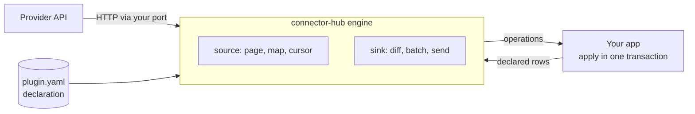

# connector-hub

A declarative connector engine for TypeScript. A connector plugin is a **declaration**: endpoints, paging, mappings and write rules, with small [CEL](https://github.com/google/cel-spec) expressions. It is not code. The engine runs every plugin the same way, and your application (the host) does all I/O through a small set of ports.

> Status: `0.x`, early development. The contract changes between minor versions until 1.0.

```sh
npm install connector-hub
```

**Documentation:** [getting started](docs/getting-started.md) · [plugin reference](docs/plugin-reference.md) · [expressions](docs/expressions.md) · [integrating a host](docs/host-integration.md) · [all docs](docs/README.md)

## How it works



- A **source** reads from the provider and turns each record into **operations** such as `upsert_booking`. Your app applies them, and the engine saves its cursor in the same transaction.
- A **sink** reads the rows it declared from your app, compares them with what it last wrote, and sends only the changes.
- A **domain pack** says which entities, fields and operations exist, such as short-term rentals or contacts. The engine itself knows nothing about any domain.

## Why declarations

SQL is powerful because a query cannot control how it runs. connector-hub applies the same idea to integrations:

| A plugin cannot… | so the engine can… |
| --- | --- |
| make network calls | enforce allowed hosts, rate limits, timeouts and body limits; replay recorded responses in tests |
| write to your database | send every change to your code as an operation, inside your transaction |
| keep state | store cursors and "last written" snapshots in your store, committed with the data |
| loop or have side effects in mappings | read which fields each mapping uses, and send only real changes |
| see fields it did not declare | give each sink exactly its declared input, nothing more |

The result: a new provider is a short file, a dry run gives you an import preview for free, and plugins can be versioned and rolled back without redeploying your application.

## Examples

Every example below is in [`examples/`](examples/src) and runs against a real public API. The screenshots are their actual output.

### 1. Read from an API

Read users from [JSONPlaceholder](https://jsonplaceholder.typicode.com) into the contacts domain:

```ts
import { compilePlugin, runSource } from 'connector-hub'
import { contactsDomain } from 'connector-hub/contacts'
import { binding, memoryHost } from 'connector-hub/testkit'

const plugin = compilePlugin(
  {
    plugin: 'jsonplaceholder-users',
    version: '0.1.0',
    engine: '^0.1',
    domain: { name: 'contacts', version: '^0.1' },
    hosts: ['https://jsonplaceholder.typicode.com'],
    sources: {
      users: {
        request: { path: '/users' },
        records: 'response.body',
        emit: [{
          operation: 'upsert_person',
          fields: {
            external_id: 'string(record.id)',
            first_name: 'record.name',
            email: 'lower(record.email)',
          },
        }],
      },
    },
  },
  contactsDomain,
)

const host = memoryHost({ http: fetchHttp() }) // fetchHttp: a few lines around fetch, see examples/src/fetch-http.ts
const result = await runSource(plugin, binding('demo'), 'users', host.ports, { dryRun: true })
```


### 2. Mistakes are caught before anything runs

`compilePlugin` checks the plugin against the domain pack and type-checks every expression. It reports every problem at once:


### 3. Incremental sync with a cursor

The Wikipedia recent-changes plugin follows `rccontinue` paging and keeps the newest edit time as its cursor. The second run fetches only what changed since:

```yaml
sources:
  edits:
    request:
      path: /w/api.php
      query:
        action: '"query"'
        list: '"recentchanges"'
        rcdir: '"newer"'
        rcstart: 'cursor != null ? cursor : config.since'   # saved cursor, or the first-run start
        rccontinue: page.cursor
    paginate: { type: cursor, next: 'has(response.body.continue) ? response.body.continue.rccontinue : ""' }
    records: response.body.query.recentchanges
    emit:
      - operation: upsert_edit
        fields:
          rev_id: string(record.revid)
          title: record.title
          size_change: record.newlen - record.oldlen
    cursor: { value: record.timestamp }
```


### 4. Write back, sending only changes

A sink declares exactly which fields it reads, how to batch them and what to send. The engine diffs against what it last wrote:

```yaml
sinks:
  tasks:
    input: { entity: task, fields: [project, title, done] }
    batch: { size: 10, by: row.project }      # one request per project
    request:
      method: PUT
      path: /put
      query: { project: batch.key }
      body: 'batch.changes.map(c, {"id": c.row.id, "title": c.row.title, "done": c.row.done})'
    ack: size(response.body.json) == size(batch.changes)
```


When the provider accepts one item per call, set `batch: { size: 1 }`. Pass `{ dryRun: true }` to `runSink` to get the plan without sending anything.

### Run them yourself

```sh
pnpm install && pnpm build
pnpm --filter connector-hub-examples quickstart   # read from an API
pnpm --filter connector-hub-examples validate     # compile errors
pnpm --filter connector-hub-examples wikipedia    # cursor paging + incremental cursor
pnpm --filter connector-hub-examples github       # page paging, page cap, skipping pull requests
pnpm --filter connector-hub-examples httpbin      # sink plan/apply: send changes only
```

## A full plugin

A booking-system plugin with OAuth, offset paging, an incremental cursor, and an availability sink grouped by listing:

```yaml
plugin: acme-pms
version: 1.0.0
engine: ^0.1
domain: { name: str, version: ^0.1 }
hosts: [https://api.acme.test]

config:
  account_id: { secret: true }
  api_secret: { secret: true }

auth:
  type: oauth2_client_credentials
  token_url: /v1/accessTokens
  client_id: secrets.account_id
  client_secret: secrets.api_secret

sources:
  reservations:
    request:
      path: /v1/reservations
      query: { limit: page.limit, offset: page.offset, updatedSince: cursor }
    paginate: { type: offset, limit: 100 }
    records: response.body.result
    emit:
      - operation: upsert_booking
        when: record.status != "test"
        fields:
          external_id: string(record.id)
          listing_id: string(record.listingMapId)
          status: 'record.status == "cancelled" ? "cancelled" : "confirmed"'
          check_in: record.arrivalDate
          check_out: record.departureDate
          total_minor: toMinor(double(record.totalPrice), 2)
    cursor: { value: record.updatedOn }

sinks:
  availability:
    input: { entity: calendar_day, fields: [available] }
    batch: { size: 30, by: row.listing_id }
    request:
      method: PUT
      path: /v1/listings/{batch.key}/calendar
      body: 'batch.changes.map(c, {"date": c.row.date, "isAvailable": c.row.available ? 1 : 0})'
    ack: response.body.status == "success"
```

Running it in your application:

```ts
import { compilePlugin, runSource, runSink } from 'connector-hub'
import { strDomain } from 'connector-hub/str'

const plugin = compilePlugin(parsedYaml, strDomain)

// Read reservations; operations and the new cursor commit in one host transaction.
await runSource(plugin, binding, 'reservations', hostPorts)

// Preview what a sink would send, then send it.
const { plan } = await runSink(plugin, binding, 'availability', hostPorts, { dryRun: true })
await runSink(plugin, binding, 'availability', hostPorts)
```

`hostPorts` is your implementation of HTTP, secrets, token cache, state, reading rows and applying operations. See [integrating a host](docs/host-integration.md).

Failures are `ConnectorError`s with a `kind` your job queue acts on: `retryable` (with `retryAfterMs` when the provider said so), `reauth`, `permanent` or `config`. The engine never retries by itself.

## What's in the package

One package, imported by path:

| Import | Contents |
| --- | --- |
| `connector-hub` | Compiler, source and sink runners, typed errors, host port types, plugin and domain-pack schemas |
| `connector-hub/str` | Short-term rental domain pack: listings, calendar days, bookings |
| `connector-hub/contacts` | Contacts domain pack: people, organisations |
| `connector-hub/testkit` | In-memory host and HTTP fixture replay for testing plugins |
| `connector-hub/cel` | The restricted CEL environment, for building tooling |
| `connector-hub/schema/plugin.schema.json` | JSON Schema for editor validation of plugin files |

Your own domain packs can live in your app or in their own package; a domain pack is a plain object checked by `DomainPack`.

## Roadmap

- Fan-out mappings: one record into many rows (`emit.each`), and per-record detail requests
- Multi-step sink writes (several requests per row, in order)
- Inbound webhooks: verification presets (including [Standard Webhooks](https://github.com/standard-webhooks/standard-webhooks)), event dedupe, re-read on signal
- Lifecycle, review and staging blocks for providers that need approval steps
- YAML loading and a CLI: `validate`, `test`, `record`, `certify`, `diff`
- Fixture recording with secret scrubbing, and a certification suite per domain pack
- Reference adapters: Postgres state and queue, `fetch` with SSRF protection
- Field ownership and echo suppression across sources and sinks

## Development

```sh
pnpm install
pnpm test
pnpm build
node scripts/screenshot.mjs quickstart   # regenerate a README screenshot
```

Node 22 or later. See [CONTRIBUTING.md](CONTRIBUTING.md) and [docs/design.md](docs/design.md).

## Licence

[Apache-2.0](LICENSE)
